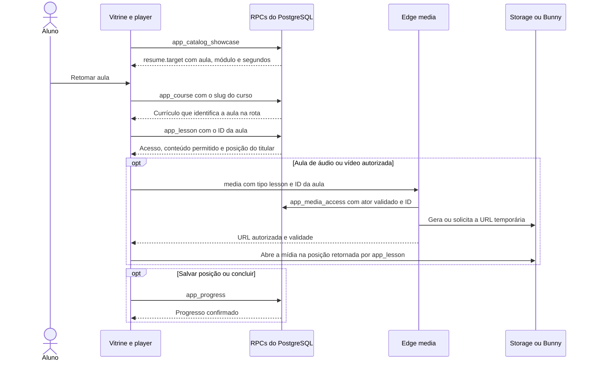
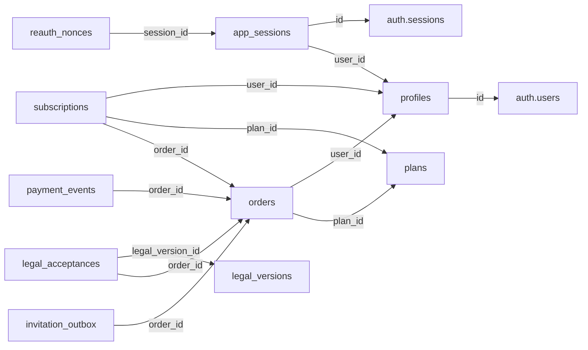
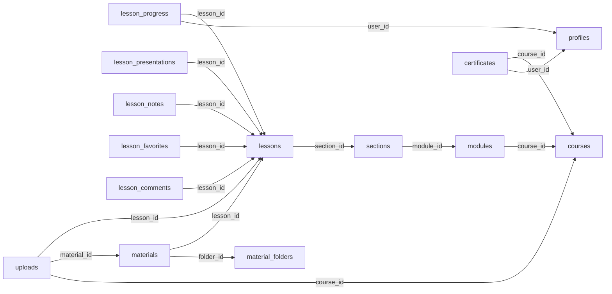
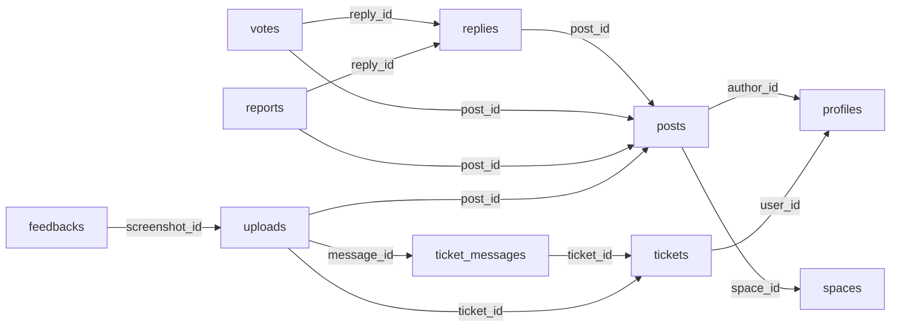

# Mapa técnico do Icarus

O Icarus oferece área de membros e entrega de cursos online para empresas e infoprodutores. Cada instalação atende uma organização.

A aplicação usa React e Vite no navegador, Supabase Auth para identidade e PostgreSQL para autorizar operações e manter os dados. O frontend consulta RPCs pelo PostgREST. As Edge Functions coordenam operações que precisam de credenciais de servidor, integrações ou URLs temporárias para arquivos.

O Icarus pode dividir um projeto Supabase com outros sistemas. Por isso, toda tabela dele em `public` leva o prefixo `ica_` (por exemplo, `public.ica_profiles`), os índices nomeados também, e as funções internas ficam no esquema `ica_private`. As RPCs expostas mantêm o prefixo `app_`.

| Para consultar | Fonte |
| --- | --- |
| Tabelas, colunas, tipos, padrões, chaves e índices | [Dicionário de dados](data-dictionary.md) |
| Assinaturas, argumentos e formatos de resposta | [Contrato](CONTRACT.md) e [API](api.md) |
| Instalação, primeiro admin, credenciais e backup | [Guia de operação](operations.md) |
| Registro de rotas e clientes Supabase | [Rotas React](../src/main.tsx) e [cliente da aplicação](../src/api.ts) |

O mapa acompanha as migrations até a **040**. Os diagramas mostram as relações centrais. O dicionário lista todas as chaves estrangeiras efetivas, inclusive compostas e autorreferentes.

## Retomar aula

| Etapa | Função e dados principais | Onde o acesso é decidido |
| --- | --- | --- |
| **Antes do clique** | [`Catalog`](../src/pages/catalog.tsx) chama [`app_catalog_showcase`](../supabase/migrations/202611230040_course_showcase.sql). Lê `ica_courses`, `ica_modules`, `ica_sections`, `ica_lessons` e `ica_lesson_progress` do titular. Procura o curso em andamento com atividade recente e escolhe uma aula pendente disponível. | `ica_private.actor` resolve o titular pela sessão. `course_access` e `lesson_access` limitam o destino. A linha `resume` pode ser nula. |
| **Navegação após o clique** | [`courseLessonPath`](../src/course-paths.ts) monta `/app/cursos/:curso/:modulo/~<id-da-aula>`. [`LessonPage`](../src/pages/learning.tsx) consulta [`app_course`](../supabase/migrations/202611230002_learning.sql) e localiza a aula pelo ID dentro do módulo. O link carrega os identificadores da rota. | A RPC valida a sessão e monta o currículo com a publicação e os indicadores de acesso de cada item. O ID do link identifica a aula. |
| **Abertura da aula** | [`app_lesson`](../supabase/migrations/202611230002_learning.sql) lê a hierarquia do curso, `ica_lesson_progress` e os metadados de `ica_materials`. A posição vem de `ica_lesson_progress.position_seconds` ou começa em zero. | `lesson_access` controla `can_access` e a entrega do corpo, da referência de mídia e dos materiais. Uma aula publicada pode aparecer no currículo com conteúdo bloqueado. |
| **Entrega da mídia** | A Edge [`media`](../supabase/functions/media/index.ts) chama [`app_media_access`](../supabase/migrations/202611230007_private_uploads.sql). Para a aula, verifica `ica_lessons` e, quando há arquivo no Storage, o vínculo com `ica_uploads` em estado `ready`. Devolve URL temporária do bucket `icarus-private` ou do Bunny. | O backend valida o usuário e a sessão antes de repetir `lesson_access`. A RPC de mídia é chamada com `service_role` pela Edge. |
| **Gravação** | [`app_progress`](../supabase/migrations/202611230028_certificate_profile_lock.sql) grava `ica_lesson_progress` pela chave `(user_id, lesson_id)`. A conclusão pode gerar um registro em `ica_certificates`. | Revalida sessão, acesso e publicação. O certificado segue a [regra de elegibilidade](../supabase/migrations/202611230015_certificate_eligibility.sql) do currículo obrigatório. |

A [regra de acesso à aula](../supabase/migrations/202611230001_core.sql) percorre curso, módulo, seção e aula. Para o aluno, considera a publicação dos quatro níveis, a indicação de prévia e, quando aplicável, o plano vigente. `ica_subscriptions` fornece a vigência e a revogação. Admin e instrutor têm regras de edição e prévia no servidor. O percentual curricular exibido no catálogo acompanha as aulas publicadas. A elegibilidade do certificado usa as aulas obrigatórias.

## Outros fluxos

| Fluxo | Caminho no código | Dados e autorização |
| --- | --- | --- |
| Entrar, aceitar convite e recuperar acesso | [Acesso](../src/pages/access.tsx) e [sessão React](../src/auth.tsx) chamam Supabase Auth. Depois da autenticação, [`app_bootstrap`](../supabase/migrations/202611230034_installation_brand.sql) fornece perfil, planos e configurações. A Edge [`password-setup`](../supabase/functions/password-setup/index.ts) conclui a primeira senha. | `auth.users`, `auth.sessions`, `auth.mfa_factors`, `ica_profiles` e `ica_app_sessions`. [`actor`](../supabase/migrations/202611230016_member_mfa.sql) valida identidade, sessão, suspensão e etapa de acesso. [AAL2 é exigido quando a conta tem fator verificado](../supabase/migrations/202611230019_optional_mfa.sql). |
| Checkout e liberação de acesso | [Checkout](../src/pages/checkout.tsx) → `checkout` → `app_checkout_begin` e `app_checkout_gateway`. O `asaas-webhook` valida o evento e chama `app_process_payment`. A finalização usa `app_finalize_paid_order` no [processamento compartilhado](../supabase/functions/_shared/payment.ts). | `ica_plans`, `ica_orders`, `ica_legal_acceptances`, `ica_payment_events`, `ica_invitation_outbox` e `ica_subscriptions`. O backend confere pagamento e vínculo com a identidade. `order-status` exige titular ou recibo válido dentro da janela. [Contrato do pagamento](CONTRACT.md#funções-edge-integrações) |
| Comunidade e moderação | [Comunidade](../src/pages/community.tsx) → `app_feed`, `app_post`, `app_save_post`, `app_reply`, `app_vote`, `app_report` e `app_moderate`. | `ica_spaces`, `ica_posts`, `ica_replies`, `ica_votes`, `ica_reports` e `ica_moderation_events`. A leitura passa por `post_access`. Escritas verificam sessão, acesso ao espaço, autoria e papel de moderação conforme a operação. [SQL da comunidade](../supabase/migrations/202611230003_community_support.sql) |
| Suporte e arquivos privados | [Suporte](../src/pages/support.tsx) → `app_tickets`, `app_ticket`, `app_create_ticket` e `app_ticket_reply`. O envio passa pela Edge `upload` e a abertura por `media`. | `ica_tickets`, `ica_ticket_messages` e `ica_uploads`. `ticket_access` controla a consulta e o anexo segundo titularidade ou papel autorizado. [SQL de arquivos](../supabase/migrations/202611230007_private_uploads.sql) |
| Dashboard e Ranking | [Dashboard](../src/pages/admin-dashboard.tsx) → `app_admin_dashboard`. [Ranking](../src/pages/ranking.tsx) → `app_ranking`. Os dois usam o seletor de período compartilhado. | Dashboard agrega `ica_profiles`, `ica_orders`, `ica_subscriptions`, `ica_lesson_progress`, `ica_posts` e `ica_tickets` com gate de admin. Ranking usa `ica_private.ranking_events` com sessão autenticada. Períodos personalizados usam dias inclusivos de Brasília. [SQL de períodos](../supabase/migrations/202611230039_report_periods.sql) |

## Relacionamentos

As setas vão da tabela que tem a chave estrangeira para a tabela referenciada. As etiquetas mostram as colunas de origem. Para facilitar a leitura, os nomes nos diagramas omitem o prefixo `ica_`.

### Identidade, sessão e acesso pago

### Currículo, progresso e mídia

### Comunidade e suporte

O modelo também tem vínculos aplicados pelo código. Por exemplo, `ica_courses.plan_ids` lista planos para a regra de acesso e o caminho de um arquivo em `ica_uploads` identifica o objeto no Storage. As setas acima representam chaves declaradas no banco.

## Edge Functions

| Função | Uso | Autorização principal |
| --- | --- | --- |
| [`capabilities`](../supabase/functions/capabilities/index.ts) | Sinaliza se as integrações estão configuradas. | Resposta pública com indicadores. |
| [`checkout`](../supabase/functions/checkout/index.ts) | Valida e cria a tentativa de checkout hospedado no Asaas. | Visita anônima ou sessão validada, com validações do plano e do aceite legal no backend. |
| [`order-status`](../supabase/functions/order-status/index.ts) | Consulta o estado do pedido. | Titular autenticado ou recibo temporário do pedido. |
| [`asaas-webhook`](../supabase/functions/asaas-webhook/index.ts) | Recebe e valida o evento de pagamento. | Token dedicado do webhook e validação de pagamento no servidor. |
| [`process-invites`](../supabase/functions/process-invites/index.ts) | Reprocessa convites pendentes de pagamento. | Operação interna com credencial de servidor. |
| [`media`](../supabase/functions/media/index.ts) | Emite URLs temporárias de arquivos e vídeos. | Sessão e permissão sobre o recurso solicitado. |
| [`upload`](../supabase/functions/upload/index.ts) | Reserva, recebe ou finaliza arquivos privados. | Sessão, permissão sobre o recurso, tipo e tamanho. |
| [`reauthenticate`](../supabase/functions/reauthenticate/index.ts) | Confirma a identidade para operações sensíveis e emite comprovante temporário. | Sessão, nova validação de senha e MFA quando exigido. |
| [`password-setup`](../supabase/functions/password-setup/index.ts) | Conclui a primeira senha de uma conta convidada. | Sessão válida para essa etapa e verificação do estado da conta. |

O arquivo de configuração do Supabase neste repositório define `verify_jwt = false` para as nove funções. Quando há autenticação de usuário, o [cliente compartilhado](../supabase/functions/_shared/client.ts) valida o token pelo Auth e confirma a sessão no backend. Veja [a configuração do Supabase](../supabase/config.toml) e as regras de cada endpoint no [contrato](CONTRACT.md#funções-edge-integrações).

## Variáveis de configuração

| Lugar | Nomes | Finalidade |
| --- | --- | --- |
| Build do navegador | `VITE_SUPABASE_URL`, `VITE_SUPABASE_ANON_KEY` | Endereço e chave pública do projeto. |
| Runtime Edge | `SUPABASE_URL`, `SUPABASE_ANON_KEY`, `SUPABASE_SERVICE_ROLE_KEY` | Conexão dos clientes da Edge. A chave de serviço fica no servidor. |
| Runtime Edge | `APP_ORIGIN`, `ICARUS_MODE`, `ICARUS_PUBLIC_SUPABASE_URL` ou `SUPABASE_PUBLIC_URL` | Origem permitida, modo da instalação e endereço público para links do Storage. |
| Asaas no servidor | `ASAAS_ENV`, `ASAAS_API_KEY`, `ASAAS_WEBHOOK_TOKEN`, `ASAAS_ITEM_IMAGE_BASE64` | Ambiente do checkout, credenciais e imagem do item. |
| Bunny no servidor | `BUNNY_LIBRARY_ID`, `BUNNY_TOKEN_KEY`, `BUNNY_ALLOWED_DOMAIN` | Biblioteca, assinatura e domínio permitido para vídeo. |
| E-mail | `EMAIL_CONFIGURED` e configuração SMTP do Supabase Auth | Indicação de configuração na interface e transporte configurado no Auth. |

Veja os [nomes do frontend](../.env.example) e os [valores e locais de configuração](operations.md#edge-functions-e-secrets).

## Atualização do mapa

Quando mudar uma tabela, gere novamente o [dicionário](data-dictionary.md) a partir do banco de teste com as migrations aplicadas. Se a mudança alterar o caminho de uma ação, atualize o fluxo correspondente neste mapa e a assinatura no [contrato](CONTRACT.md).
